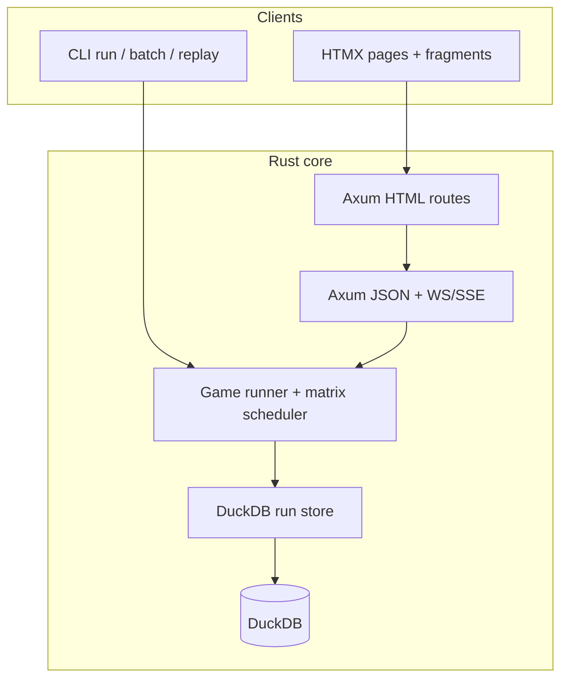

# Plan: AI Arena Roadmap (Server, UI, Persistence, Scale)

## Overview

This plan aligns `TODOS.md` with the current codebase and sequences the remaining work: **observation**, **replay**, **matrix + parallelism**, and **new games**. It incorporates accepted product decisions:

| Decision | Choice |
|----------|--------|
| UI direction | **HTMX-first**: server-rendered UI from Rust/Axum; no npm/Vite/React dependency for the product UI |
| Completed foundation | Server mode, HTMX product UI, and DuckDB run history |
| Persistence | **DuckDB run history** for CLI, CSV, and web sessions |

**Source of truth for backlog:** `TODOS.md`  
**Related existing plans:** `plans/secret-configuration-separation.md`, `plans/ollama-agent-support.md`

---

## Current State (July 2026)

### Implemented

- **CLI** (`src/main.rs`): `run`, `batch`, `serve`, `secrets` subcommands
- **Games**: TicTacToe, RockPaperScissors, ConnectFour, Chess, Checkers, Battleship (`src/games/`)
- **Agents**: OpenAI, Anthropic, Gemini, Ollama; shared move contract (`MoveRequest` / `MoveResponse`)
- **Stats**: Per-turn `GameStats` with CLI table output (`src/games/display.rs`)
- **Batch**: Sequential CSV runner (`src/csv_runner.rs`)
- **Server**: Axum REST + WebSocket, configurable bind address, optional static serving (`src/server/mod.rs`)
- **Web**: HTMX product UI at `/` can start games, list sessions, and observe the board, status, and battle log through polling.
- **Secrets**: TOML profiles + optional encryption (`src/secrets.rs`)
- **Tests**: Rust unit/integration tests passing (`cargo test`)

### Gaps vs `TODOS.md`

| TODO item | Status |
|-----------|--------|
| Server binds to chosen host/port | Done — `serve --host` / `--port` |
| Web UI at root (HTMX) | Done — create games, list sessions, and observe status |
| Checkers | Done — forced captures, chained jumps, and king promotion |
| Battleship | Done — hidden opponent fleet state and shot validation |
| Game matrix (hundreds of sims) | Not started |
| Parallel game execution | Not started |
| Observe any game (CLI + web, many parallel) | Partial — single-game web observation exists; CLI `run --watch` and matrix click-through remain |
| Replay | Not started |
| Persist games (DB) | Done — DuckDB run history for CLI, CSV, and web |
| Optional: per-AI prompts, leaderboard on disk | Partial — `prompt.rs` exists; no leaderboard |

### Doc / stack drift

- New HTMX markup uses Askama templates in `templates/`
- HTMX routes, templates, and route tests are first-class Axum features
- The browser UI works directly from the Rust binary without an npm build step

---

## Architecture Target



**Principles**

1. **One game event contract** — replace ad hoc `serde_json::Value` observer payloads with a typed `GameEvent` (turn, state snapshot, error, complete) used by CLI, HTMX fragments/streams, and persistence.
2. **Server owns sessions** — in-memory active runs; durable history in DuckDB.
3. **HTMX product UI** — HTML routes and fragments are first-class; JSON/WS/SSE endpoints exist only where they simplify streaming, testing, or external use.

---

## Database Recommendation

### Decision: **DuckDB as run-history store**

DuckDB is now the selected local system of record for game runs. It keeps the project service-free while making later aggregate/statistical queries over many matches straightforward.

### Implemented schema shape (DuckDB)

```sql
-- runs: one logical match (may be one row in a matrix job)
CREATE TABLE runs (
  id TEXT PRIMARY KEY,
  game_type TEXT NOT NULL,
  status TEXT NOT NULL,
  created_at TEXT NOT NULL,
  started_at TEXT,
  finished_at TEXT,
  winner TEXT,
  draw BOOLEAN NOT NULL DEFAULT false,
  error TEXT,
  total_turns BIGINT,
  invalid_moves BIGINT,
  total_duration_ms BIGINT,
  agents_json TEXT NOT NULL,
  game_config_json TEXT NOT NULL,
  result_json TEXT,
  metadata_json TEXT
);

CREATE TABLE run_turns (
  run_id TEXT NOT NULL,
  seq BIGINT NOT NULL,
  turn_number BIGINT NOT NULL,
  player TEXT NOT NULL,
  move_json TEXT NOT NULL,
  valid BOOLEAN NOT NULL,
  error TEXT,
  time_taken_ms BIGINT NOT NULL,
  state_before_json TEXT NOT NULL,
  state_after_json TEXT NOT NULL,
  diagnostics TEXT,
  PRIMARY KEY (run_id, seq)
);
```

**Crate:** `duckdb` with bundled DuckDB, called behind a small blocking boundary.

---

## Phased Roadmap

### Phase 0 — Hygiene (parallel, low risk)

**Goal:** Reduce confusion before feature work.

- [x] Update `README.md` to document subcommands, all games, Gemini, `serve`, secrets
- [x] Reconcile `TODOS.md` (mark Connect Four done; note HTMX direction)
- [x] Add Gemini to `csv_runner` agent kind parsing
- [x] Fix existing prototype `POST /api/games` body to send `secret_profile`, `api_endpoint`, `seed`, `temp`
- [x] Wire or remove orphan `src/secrets_test.rs`
- [x] Address high-signal warnings (`secrets_manager.set` Result in `main.rs`)

**Exit:** Docs match code; CSV and request configs consistent with `AIAgentConfig`.

---

### Phase 1 — Server mode foundation (Milestone 1 — priority)

**Goal:** Production-shaped `serve` suitable for tests and HTMX routes.

**CLI**

```bash
ai_arena serve --host 0.0.0.0 --port 3000
```

**Tasks**

- [x] Add `--host`, `--port` (defaults: `127.0.0.1`, `3000`) to `Serve` subcommand
- [x] Bind `TcpListener` to configured address; log effective URL
- [x] Serve static assets from `--static-dir` when set (`tower_http::services::ServeDir`)
- [x] `GET /api/games` — list in-memory sessions (id, game type, status) for UI matrix later
- [x] Standardize error responses (JSON `{ "error": "..." }` already partial)
- [x] **Tests:** integration tests using `axum::test` or `reqwest` against spawned server:
  - health returns 200
  - server listens on chosen port (ephemeral port in test)
  - create game returns `game_id`; invalid game type returns 400
  - static route serves files from the configured directory

**Exit:** `cargo test` includes server tests; `ai_arena serve` configurable; ready for HTMX routes at `/`.

---

### Phase 2 — HTMX UI foundation

**Goal:** The Rust server renders the product UI at `/`; no npm build step required.

**Tasks**

- [x] Add server-side HTML rendering with base layout and HTMX script import
- [x] `GET /` — render game start page with game selector, two agent forms, and existing secret profiles
- [x] `POST /games/start` — validate form input, create a game session, and return a game panel fragment
- [x] `GET /games` or root run list fragment — show in-memory sessions (id, game type, status)
- [x] `GET /games/{id}` — render a game observation page
- [x] `GET /games/{id}/fragment` — render current status/board/log fragment for polling
- [x] Keep JSON routes available for tests and future integrations, but do not build product UI in React/Vite
- [x] Add route tests for root page, start form validation, and session list fragment

**Exit:** `ai_arena serve` opens an HTMX page at `/` that can create a game and show its status without `npm run build`.

---

### Phase 3 — Typed events + CLI observation

**Goal:** Establish one typed event contract and add CLI live observation. The web already offers polling-based observation for a single game; matrix click-through is Phase 5.

**Status:** Complete (July 2026).

**Tasks**

- [x] Define `GameEvent` enum in `src/games/events.rs`
- [x] Emit typed turn, completion, and error events from each game engine
- [x] Refactor the existing HTMX polling fragments to consume typed events
- [x] CLI `run --watch`: print board/state each turn to stderr
- [x] HTMX: map turn events to the human-readable board/status fragment
- [x] Chess: include FEN and the last move in state events

**Exit:** One CLI game and one web game show the same turn sequence; no silent stuck loops without timeout (document per-game invalid-move policy).

---

### Phase 4 — Replay from DuckDB history

**Goal:** Build replay on the existing DuckDB run and turn history (TODOS: replay).

**Status:** Complete (July 2026).

**Tasks**

- [x] `trait GameStorage { create_run, append_event, finish_run, get_run, list_events }`
- [x] DuckDB implementation for CLI `run`, CSV `batch`, and server game sessions
- [x] Add migration/version tracking for the DuckDB schema
- [x] `GET /api/runs/{id}` and `GET /api/runs/{id}/events`
- [x] CLI: `ai_arena replay <run_id>` — stdout turn-by-turn replay
- [x] Web: server-rendered replay page backed by stored turns

**Exit:** Completed game recoverable after server restart (at least for runs finished while server was up); replay reproduces turn sequence.

---

### Phase 5 — Matrix runner + parallelism

**Goal:** Run hundreds of simulations with live progress (TODOS: matrix UI, parallel games).

**Status:** Complete (July 2026).

**Tasks**

- [x] `MatrixJob` model: game type, two-agent matchup, repetitions, concurrency limit
- [x] `POST /api/matrix` — start job; `GET /api/matrix/{id}` — progress (queued/running/done/failed counts)
- [x] Worker pool (`tokio::spawn` + `Semaphore`) — configurable cap, default 4, maximum 32
- [x] Each child run gets `run_id`; the run records its `matrix_job_id` and persisted turn history
- [x] HTMX matrix builder form
- [x] HTMX results table updating through polling
- [x] Each row links to live observation or replay for that run

**Exit:** 100+ game job completes with bounded parallelism; UI shows per-run status; click-through opens live observer or replay.

---

### Phase 6 — Checkers and Battleship

**Goal:** Add the two remaining planned games.

**Status:** Complete (July 2026).

**Tasks**

- [x] **Checkers:** 8×8, forced jumps (including chains), king promotion, and rule tests
- [x] **Battleship:** hidden opponent fleet state, shot coordinate schema, and bounded turn count
- [x] Register both games in `Game::new`, CSV, server, and HTMX UI
- [x] Update the README game table and examples

**Exit:** Each game has unit tests for rules and one smoke LLM match documented in the plan or README.

---

### Phase 7 — Optional backlog

**Status:** Complete (July 2026).

- [x] Per-agent custom prompts via paths in `AIAgentConfig`; prompt contents remain outside run history
- [x] DuckDB-backed leaderboard aggregate for completed runs
- [x] Example DuckDB analytics queries
- [x] CI: formatting, check, test, and clippy in GitHub Actions
- [x] Optional bearer token for server routes when binding beyond localhost

---

## Risks and Mitigations

| Risk | Mitigation |
|------|------------|
| Missing API keys panic via `.expect()` | Return `Result` from `build_agents`; surface 400/500 in API |
| Invalid moves cause infinite loops | Per-game max invalid retries; global max turns; mark run failed |
| LLM cost / rate limits on matrix | Concurrency cap; optional dry-run/mock agent for tests |
| UI and JSON endpoints diverge | HTMX route tests plus a small documented API/event contract |
| DuckDB write contention on huge matrix | Batch inserts; single writer task per process |
| Frontend complexity creeps back in | Keep product UI server-rendered; no npm/Vite/React required for core flows |

---

## Success Metrics

| Phase | Metric |
|-------|--------|
| 1 | Server integration tests green; bind on arbitrary port verified |
| 2 | HTMX root page starts and creates one game without npm |
| 3 | CLI and HTMX UI show identical turn count for same `run_id` |
| 4 | Replay from DB matches original event stream |
| 5 | Matrix of ≥100 games completes; no OOM at default concurrency |
| 6 | Checkers and Battleship unit tests + recorded agent matches |

---

## Implementation Order (summary)

1. **Phase 3** — typed `GameEvent` + CLI observation
2. **Phase 4** — replay on top of the existing DuckDB history
3. **Phase 5** — matrix + parallelism
4. **Phase 6** — Checkers and Battleship
5. **Phase 7** — optional analytics and polish

---

## Out of Scope (this plan)

- Multi-user auth and hosted Postgres (until deployment model is chosen)
- Full chess board renderer (minimal FEN is acceptable until explicitly prioritized)
- “Allow cheating” mode from README open questions
- Maintaining React/Vite as a product UI path

---

## Acceptance

This plan is **accepted** when stored at `plans/ai-arena-roadmap.md` and used as the sequencing reference for implementation PRs. Next implementation slice: **Phase 3 — typed events and CLI observation**.
